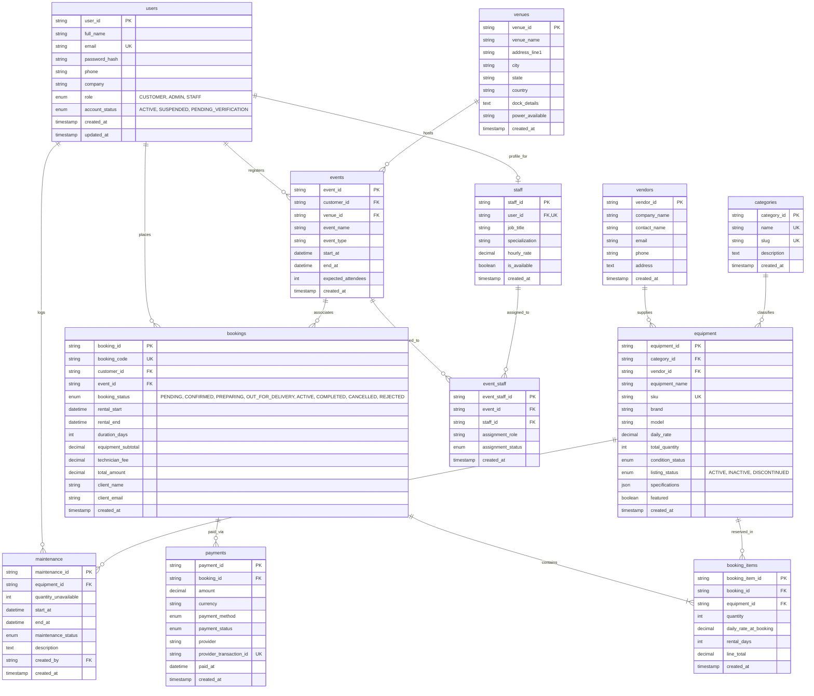

# AURA Event Equipment Management System — Entity Relationship Diagram

This document specifies the relational database model for **`event_equipment_db`** (MySQL 8.0+ / InnoDB engine).

---

## 1. Visual Entity-Relationship Diagram (Mermaid)

---

## 2. Table Specifications and Relationship Rules

| Table Name | Primary Key | Foreign Keys | Key Constraints & Integrity Rules |
| :--- | :--- | :--- | :--- |
| **`users`** | `user_id` (UUID/VARCHAR) | None | Unique `email`. Check constraints on roles. Passwords stored only as bcrypt hashes. |
| **`vendors`** | `vendor_id` (UUID/VARCHAR) | None | Vendor details. `ON DELETE SET NULL` on referencing equipment. |
| **`categories`** | `category_id` (VARCHAR) | None | Unique `name` and `slug`. `ON DELETE RESTRICT` protects catalog hierarchy. |
| **`equipment`** | `equipment_id` (VARCHAR) | `category_id`, `vendor_id` | Unique `sku`. Check `daily_rate >= 0` and `total_quantity >= 0`. Indexed on `category_id`, `listing_status`, `daily_rate`. |
| **`venues`** | `venue_id` (UUID/VARCHAR) | None | Physical locations with dock & power details. |
| **`events`** | `event_id` (UUID/VARCHAR) | `customer_id`, `venue_id` | Check `end_at > start_at`. Protected customer history with `ON DELETE RESTRICT`. |
| **`bookings`** | `booking_id` (VARCHAR) | `customer_id`, `event_id` | Unique `booking_code`. Check `rental_end > rental_start`. Financial fields stored in `DECIMAL(10,2)`. |
| **`booking_items`**| `booking_item_id` (UUID) | `booking_id`, `equipment_id` | Composite UNIQUE(`booking_id`, `equipment_id`). Frozen `daily_rate_at_booking`. `ON DELETE CASCADE` from booking. |
| **`payments`** | `payment_id` (UUID) | `booking_id` | Unique `provider_transaction_id`. Never stores raw credit card credentials. `ON DELETE RESTRICT` protects audit logs. |
| **`maintenance`** | `maintenance_id` (UUID) | `equipment_id`, `created_by` | Check `end_at > start_at` and `quantity_unavailable > 0`. Reduces available booking stock for date overlap. |
| **`staff`** | `staff_id` (UUID) | `user_id` | 1-to-1 extension of `users` (`user_id` is UNIQUE). `ON DELETE CASCADE` with user account. |
| **`event_staff`** | `event_staff_id` (UUID) | `event_id`, `staff_id` | Composite UNIQUE(`event_id`, `staff_id`). Tracks technician staffing per event production. |

---

## 3. Availability Calculation Logic

For any given `equipment_id` over a half-open rental period $[T_{\text{start}}, T_{\text{end}})$:

$$\text{Available Quantity} = Q_{\text{total}} - Q_{\text{reserved}} - Q_{\text{maintenance}}$$

Where:
1. $Q_{\text{total}}$ is `equipment.total_quantity`.
2. $Q_{\text{reserved}}$ is the sum of `booking_items.quantity` for all overlapping bookings where `bookings.booking_status IN ('PENDING', 'CONFIRMED', 'PREPARING', 'OUT_FOR_DELIVERY', 'ACTIVE')` and:
   $$\text{rental\_start} < T_{\text{end}} \quad \text{AND} \quad \text{rental\_end} > T_{\text{start}}$$
3. $Q_{\text{maintenance}}$ is the sum of `maintenance.quantity_unavailable` for all overlapping records where `maintenance_status IN ('SCHEDULED', 'IN_PROGRESS')` and:
   $$\text{start\_at} < T_{\text{end}} \quad \text{AND} \quad \text{end\_at} > T_{\text{start}}$$
